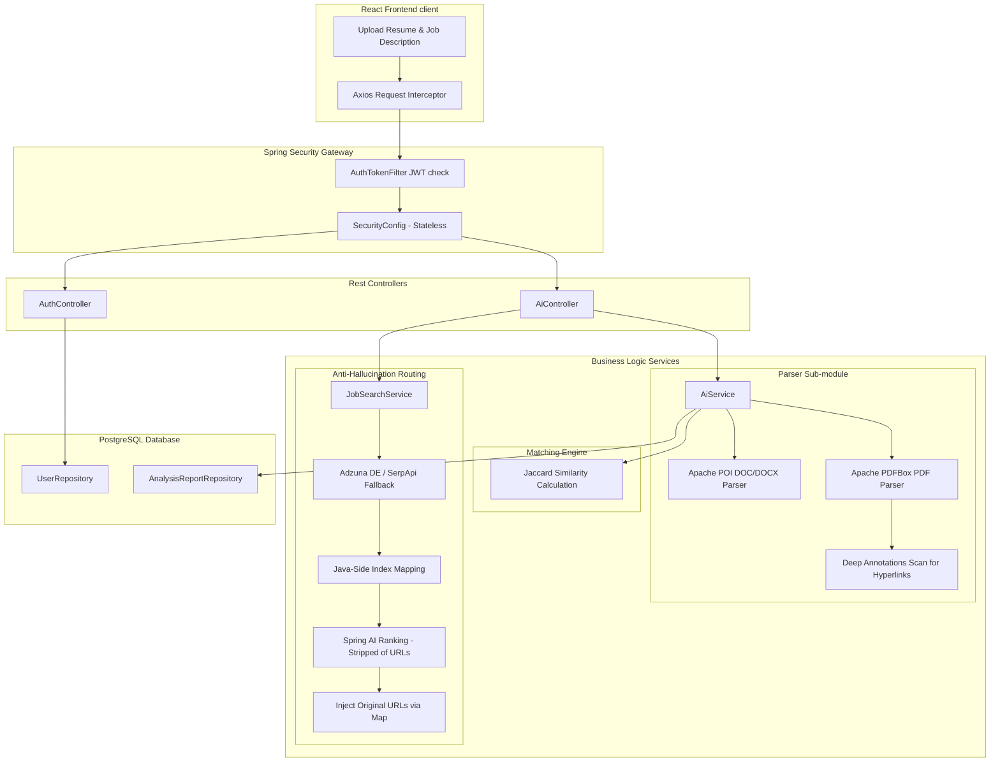

# AI Job Assistant — Full System Specification & Documentation

An elite, full-stack AI-powered career assistant that parses resumes, analyzes compatibility with job descriptions, generates tailored cover letters, queries live job boards with geo-targeting, and hosts an interactive career advisory chat.

---

## 🛠️ 1. Complete Technology Stack & Libraries

### ☕ Backend (Server-Side)
* **Core Language:** Java 17+
* **Framework:** Spring Boot 3.5.13
* **Build Automation:** Maven
* **Database & Persistence:**
  * **Database Engine:** PostgreSQL
  * **Object-Relational Mapping (ORM):** Spring Data JPA (Hibernate Dialect)
  * **Schema Management:** Automated Hibernate `update` DDL strategy
* **Security & Cryptography:**
  * **Framework:** Spring Security 6
  * **Session Model:** Stateless JWT (JSON Web Tokens)
  * **Hashing Algorithm:** BCrypt (`BCryptPasswordEncoder`)
* **AI & Large Language Model (LLM) Orchestration:**
  * **Framework:** Spring AI (v1.1.4 Boms managed)
  * **AI Provider:** Groq Cloud API (utilizing `llama-3.1-8b-instant` or OpenAI-compatible configurations)
* **Document Parsing Utilities:**
  * **PDF Reader:** Apache PDFBox (v3.0.1) for loading and scanning PDF binaries.
  * **Word Document Reader:** Apache POI (`poi-ooxml` and `poi-scratchpad` v5.5.1) for parsing modern `.docx` and legacy `.doc` files.
* **Environment Configuration:**
  * `spring-dotenv` (v4.0.0) for loading external, encrypted, or configuration secrets from a `.env` file automatically at application startup.

### ⚛️ Frontend (Client-Side)
* **Core Library:** React 18
* **Build System & Dev Server:** Vite
* **Routing:** React Router DOM (v6)
* **Design & Styling System:**
  * Custom Vanilla CSS3 featuring a premium **Glassmorphism design system**
  * Radial gradient orbital glows (`bg-orb-1`, `bg-orb-2`)
  * Smooth animations, responsive flex and grid layouts, and active element transforms
* **API Communication:**
  * Axios (v1.6+) with global interceptors to attach `Bearer <JWT>` headers dynamically to all requests.
* **Content Rendering:**
  * `react-markdown` (v9+) to cleanly format AI response structures.

---

## ⚙️ 2. Core Architectural Processes

This system utilizes advanced heuristics and design patterns to ensure mathematical matching, security, and zero-hallucination URL stability.



### 📄 Process A: Deep Document Parsing & Hidden Hyperlink Extraction
When a user uploads a PDF or Word file to `AiController.java`, the system runs a multi-threaded format detector:
1. **PDF Format:** Uses `PDFTextStripper` to extract pure text. Simultaneously, it iterates over all pages to inspect annotations (`PDAnnotationLink`). For each link, it extracts the destination URI (`PDActionURI`).
2. **DOCX Format:** Loads a `XWPFDocument` and calls `XWPFWordExtractor` to extract text. It also queries `doc.getHyperlinks()` to fetch all embedded URLs.
3. **Link Integration:** Found URLs (often hidden behind clickable icons or logos in modern resumes) are appended at the bottom of the document as `EXTRACTED HYPERLINKS (HIDDEN)`. This prevents the LLM from losing contact info (e.g. LinkedIn, Portfolio) that isn't written in plain text.

### 📐 Process B: The Jaccard Similarity Algorithm (Normalized Skill Overlap)
Instead of letting the LLM estimate a match score, which introduces subjective bias and inconsistency, the backend uses a mathematical Jaccard Similarity index:
1. **Extraction:** The LLM is prompted using strict delimiters (`---REQUIRED_SKILLS_START---` and `---CANDIDATE_SKILLS_START---`) to return list candidates.
2. **Fuzzy Normalization:** The CSV lists are extracted and normalized in Java:
   * Stripped of version labels (`Java 17` -> `java`).
   * Stripped of file extensions and endings (`React.js` -> `react`, `ReactJS` -> `react`, `NodeJS` -> `node`).
   * Canonical aliases mapped (`postgres` -> `postgresql`).
3. **Computation:** A mathematical intersection set is created:
   $$\text{Match Score} = \text{round}\left( \frac{|\text{Candidate Skills} \cap \text{Required Skills}|}{|\text{Required Skills}|} \times 100 \right)$$
   This ensures that the score displays a mathematically verifiable metric of skill overlap.

### 🔒 Process C: Live Job Hunter & Zero-Hallucination Link Router
The live job board feature has a specialized routing pipeline to combat AI hallucinations of web links:
1. **Resume Analysis:** The user's resume is analyzed by Spring AI to extract a general, 2-3 word target job title (e.g. `Full Stack Developer`). Geolocation phrases are stripped.
2. **API Search:** The query is sent to the **Adzuna Germany API** (`/de/` endpoint) to locate active German jobs. If Adzuna credentials are unconfigured, it falls back to **SerpApi (Google Jobs)**.
3. **URL Stripping (Security Wall):** A list of `JobEntry` objects is compiled in memory. A temporary JSON structure is sent to the LLM containing the job details **but completely stripped of all URLs**.
4. **Ranking & Mapping:** The LLM ranks the top 5 jobs and outputs a JSON containing only their indices (`idx`), matches, and scoring reasons.
5. **Re-injection:** The Java service reads the LLM-selected indices and maps them back to the original stable API links from memory before delivering the payload to the client. This guarantees 100% stable application URLs.

---

## 💾 3. Database Schema

Managed by PostgreSQL and Spring Data JPA.

```
                  ┌──────────────┐
                  │    users     │
                  ├──────────────┤
                  │ id (PK)      │ <──┐
                  │ email        │    │
                  │ password     │    │ (1 to Many)
                  │ name         │    │
                  │ created_at   │    │
                  └──────────────┘    │
                         │            │
                         └────────────┼───┐
                                      │   │
                             ┌────────v───┴──────────┐
                             │    analysis_report    │
                             ├───────────────────────┤
                             │ id (PK)               │
                             │ job_title             │
                             │ match_score           │
                             │ missing_skills (LOB)  │
                             │ cover_letter (TEXT)   │
                             │ user_id (FK)          │
                             │ created_at            │
                             └───────────────────────┘
```

### Table 1: `users` (User Authentication Store)
* `id` (`BIGINT`): Primary Key, auto-incrementing.
* `email` (`VARCHAR`, Unique, Non-Nullable): Used as username.
* `password` (`VARCHAR`, Non-Nullable): BCrypt encrypted hash.
* `name` (`VARCHAR`): Display name.
* `created_at` (`TIMESTAMP`): Automatically set via `@PrePersist`.

### Table 2: `analysis_report` (Job & Resume Matches History)
* `id` (`BIGINT`): Primary Key, auto-incrementing.
* `job_title` (`VARCHAR`): Truncated string from the job description.
* `match_score` (`INTEGER`): Calculated Jaccard coefficient (0-100).
* `missing_skills` (`VARCHAR` / `@Lob`): Stores the missing skills, ATS recommendations, and improvements.
* `cover_letter` (`TEXT`): The tailored cover letter.
* `user_id` (`BIGINT`, Foreign Key): Joins to `users.id` with lazy fetching.
* `created_at` (`TIMESTAMP`): Timestamp of the analysis run.

---

## 🔌 4. API Endpoints Specification

### Authentication Sub-system (`/api/auth/**`)
*Endpoints in this group do not require token authentication.*

| Method | Endpoint | Payload Request | Response Payload | Description |
| :--- | :--- | :--- | :--- | :--- |
| **POST** | `/login` | `{"email": "...", "password": "..."}` | `{"token": "...", "id": 1, "email": "..."}` | Authenticates user; returns signed JWT. |
| **POST** | `/signup` | `{"name": "...", "email": "...", "password": "..."}` | String response: `"User registered successfully!"` | Creates a new user with BCrypt-hashed password. |

### AI and Job Operations Sub-system (`/api/ai/**`)
*All requests require the header:* `Authorization: Bearer <JWT_TOKEN>`

| Method | Endpoint | Payload Request (Form-Data / Query) | Response Payload (JSON) | Description |
| :--- | :--- | :--- | :--- | :--- |
| **POST** | `/analyze` | Multipart: `jobFile` (PDF/Word), `resumeFile` (PDF/Word) | `AnalysisReport` Entity JSON | Extracts text, calculates Jaccard score, prompts LLM, saves report. |
| **GET** | `/history` | None | `List<AnalysisReport>` (sorted newest first) | Fetches user's previous scans. |
| **DELETE** | `/history/{id}` | Path Variable: `id` | Empty response status `200` | Deletes a report from history. |
| **POST** | `/cover-letter` | Multipart: `jobFile`, `resumeFile`. Optional query: `reportId` | Tailored Cover Letter in raw markdown | Generates/regenerates a cover letter and updates the database record if `reportId` is provided. |
| **POST** | `/chat` | Form Parameter: `message` (String). Optional Multipart: `resumeFile` | AI Career Advice in markdown | Chats with J.A.R.V.I.S. with context of the uploaded resume. |
| **POST** | `/find-jobs` | Multipart: `resumeFile` | JSON Array of matched jobs with score, reason, and stable URL | Finds German job listings matching the user's resume profile. |

---

## 🔒 5. Security & Authentication Architecture

1. **Stateless Request Interceptor:**
   Spring Security is configured to keep sessions completely stateless. The custom class [AuthTokenFilter](file:///c:/Users/HP/Desktop/AI%20Job%20Assistant/backend/src/main/java/com/example/demo/security/AuthTokenFilter.java) executes once per request. It checks for the `Authorization: Bearer <token>` header, parses and verifies the token's validity, and populates the `SecurityContextHolder` with a `UsernamePasswordAuthenticationToken` if verified.
2. **CORS Protocol:**
   The backend explicitly manages Cross-Origin Resource Sharing in [SecurityConfig](file:///c:/Users/HP/Desktop/AI%20Job%20Assistant/backend/src/main/java/com/example/demo/security/SecurityConfig.java). It permits origins matching `http://localhost:5173` and deployment patterns like `https://ai-job-assistant-*.vercel.app` (enabling wildcard subdomains for Vercel branch builds). Allowed headers include `Authorization`, `Content-Type`, and `Cache-Control`.
3. **Password Salting:**
   Raw passwords are never stored. The [AuthController](file:///c:/Users/HP/Desktop/AI%20Job%20Assistant/backend/src/main/java/com/example/demo/controller/AuthController.java) applies a `BCryptPasswordEncoder` block when users register, securely salting and hashing credentials.

---

## 🌟 6. System Advantages & Merits

* **Mathematical Jaccard Scoring:** By utilizing a normalized Jaccard algorithm instead of LLM-generated matching percentages, the tool remains objective and reliable.
* **100% Stable Apply Links:** Since URLs are filtered out before sending content to the LLM and mapped back inside Java memory, links never break or hallucinate.
* **Deep Annotation Inspection:** Deep scanning parses URLs hidden behind hyperlinked social icons in PDFs or Word documents.
* **Sleek Glassmorphism Interface:** Visual layout with glass blur effects, high-contrast visual indicators, progress meters, and dynamic CSS transitions.
* **German Market Target Optimization:** Uses targeted queries on Adzuna's `/de/` endpoints to retrieve relevant local opportunities.

---

## ⚙️ 7. Environment Setup & Configuration

### Backend `.env` File (located in `backend/` directory)
```env
# Database Configuration
DB_URL=jdbc:postgresql://localhost:5432/ai_job_assistant
DB_USERNAME=postgres
DB_PASSWORD=your_postgres_password

# AI / LLM Configuration (Groq)
GROQ_API_KEY=your_groq_api_key_here

# JWT Secret (Must be a secure key, at least 32 bytes long)
JWT_SECRET=your_super_secret_jwt_key_at_least_32_characters_long

# Adzuna API Keys (Get from developer.adzuna.com)
ADZUNA_APP_ID=your_adzuna_app_id
ADZUNA_APP_KEY=your_adzuna_app_key
```

### Frontend `.env` File (located in `frontend/` directory)
```env
# Points the frontend axios client to the correct server url
VITE_API_BASE_URL=http://localhost:8080
```

---

## 🛠️ 8. Running the Application Locally

1. **Spin up your PostgreSQL Database** and ensure the database `ai_job_assistant` is created.
2. **Start the Spring Boot Backend:**
   Ensure you are in the `backend/` directory and run:
   ```bash
   mvn spring-boot:run
   ```
3. **Start the React Frontend:**
   Ensure you are in the `frontend/` directory, install packages, and spin up the Vite development server:
   ```bash
   npm install
   npm run dev
   ```
4. **Access the Application:** Open your browser and navigate to `http://localhost:5173`. Create an account, log in, and start tracking your job applications!
